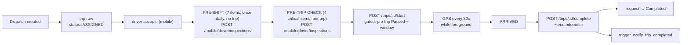

# Feature: Trips

## Standalone INTERNAL Cargo execution - 2026-10-27

Cargo requests saved from Add Reservation now have an INTERNAL-only execution provider. The assigned driver records the existing item counts, photos and paired handover signatures on the phone. Fleet Manager/admin/super_admin staff inspect the saved record in Cargo Review: explicit pickup acceptance is followed by a separate assignment-bound safe-loading review before departure; receiving is reviewed against its own saved receipt. Recounts and resource changes invalidate the relevant release, and recorded pickup retains custody holds on cancellation/reassignment. Exact retries reuse immutable command responses. External Cargo providers remain unavailable.

Migration170 is applied and its private review records pass the live catalog contract. Eight actual isolated PostgreSQL cases cover the lifecycle and manager authority; actual intake rollback and independent focused review also passed. Local backend3000 and dedicated phone Metro8082 now serve the implementation checkout. Full operating delivery/physical phone acceptance remains pending genuine driver and vehicle readiness. See [[Internal Cargo Execution Implementation 2026-10-27]] and [[Internal Cargo Continuation Checkpoint 2026-10-27]].

## Current Android trip shortcut - 2026-10-16, Task 5

The Android-only bubble is implemented in source through `2ca921c0`, including optional permission/Maps integration and authenticated return/cleanup. The user's explicit build request superseded the earlier implementation-start hold below; native and physical acceptance remain **PENDING**. It is one private return icon, with no trip details or state-changing action. Tapping returns through existing authentication/consent guards and canonical assignment refresh; the URL never selects or authorizes a trip. Passenger and Cargo keep the same navigation, tracking and lifecycle authority.

Only successful existing tracking readiness can offer/arm the shortcut. Denial, Back, unsupported or older native builds and native failure keep navigation usable; Continue Without Tracking skips the bubble. Its presence proves neither GPS delivery nor distance continuity. The existing tracking notification remains the fallback. A fresh custom native build is required, and force-stop still ends tracking under [[ADR-011 Background GPS Tracking]].

Task 5 verification: 1,183/1,183 mobile tests in 82 files, full zero-warning lint, encoding and whitespace passed. Native JUnit/debug assembly and separate manifest merging each stopped before compilation because Java/JAVA_HOME is absent; SDK/ADB/device and ignored Google services configuration are also absent. Kotlin compile, ten JUnit cases, merged manifest, APK and every physical permission/drag/return/cleanup/accessibility/GPS check remain pending. [[Tracking]] holds the complete unperformed matrix and exact evidence. The untracked main-checkout source plan was preserved; task ledger/report record its status exception.

## Android bubble return - 2026-10-16, Task 4

The return link now waits for restored driver authentication and routes through the existing Map/consent guards. Its trip ID is only a validated hint: Map reloads the current assignment from the existing driver-trips endpoint and never uses that ID to authorize, select or mutate a trip. Confirmed completion/cancellation, replacement, failed restore and session boundaries remove/invalidate obsolete shortcuts. The user's earlier explicit build authorization supersedes the historical Release 2 implementation hold below; native compilation and physical acceptance remain pending. Verification: focused 231/231 and full mobile 1,178/1,178 tests (82 files), strict touched lint, encoding and whitespace passed. See [[Tracking]].

## Google Maps handoff acceptance - PENDING (2026-10-15, Task 7)

Passenger and Cargo share the trusted pickup/destination phase rules and ordered tracking-readiness handoff. Driver Accepted and Trip Started select pickup; Passenger Onboard, En Route, Drop-off, Arrived and In Progress select destination. Launch does not advance trip status. Readiness failure requires the explicit Continue Without Tracking choice; Stay Here and Back keep the driver in FleetOps. Returning stops and merges the returning trip's distance before refreshing the canonical assignment, and server-rejected/ended trips lose their background context.

Task 6 committed automated evidence (`8d5b38e8`): release gate 21/21, all mobile library tests 1,089/1,089 in 77 files, full zero-warning lint, encoding/whitespace and Android Hermes export (1,468 modules, 87 assets, 5,698,753 bytes). These are not physical acceptance. Task 7 found no Android tooling, SDK/AVD, running emulator or present Android device; no build was installed and no moving/permission/notification/distance measurements were taken. Native Google services configuration is also absent from the isolated checkout. The complete unperformed device matrix and evidence fields are in [[Tracking]]. Cargo production integration remains disabled.

Release 1 physical acceptance remains **PENDING**. Historical Task 7 implementation hold: Release 2 was then blocked and unimplemented pending device evidence and confirmation about notification return. The subsequent informed user request superseded that implementation-start hold; the current source feature is described above, with native/device acceptance still pending. No production trip, provider, database or deployment change was made by this acceptance documentation.

## Cargo-only dual signatures - 2026-10-20

New Cargo pickup/delivery observations now require releasing/receiving staff acknowledgment of the exact reviewed item counts and condition. The shared native modal captures signer name/role or department, a bounded drawing, device time and optional honest GPS. It freezes the reviewed snapshot; counts, issues, manifest, account/session and assignment changes cannot reuse stale acknowledgment. Exact draft retries preserve the original signature/submission; recount creates a fresh signed receipt and keeps history. Passenger trips have no cargo signatures. Starting/ending odometer capture remains shared for Passenger and Cargo with its existing timing/transactions.

Signatures extend existing private immutable receipt JSON, so no duplicate table/API or migration was added. Unsigned history and original command replay remain readable, but unsigned current receipts cannot supply new departure/completion/Fleet clearance. Source, Fleet securement and independently resolved receiving proof remain separate; a drawing or incident ID supplies no bypass. Production cargo authority remains intentionally unconfigured/503.

Trip Details includes an explicit View signatures action in the cargo verification panel. Authorized detail reads alone return private drawings/names/location; default reads and all partner outbox/source-decision HTTP responses exclude them. Evidence stays in session/trip-scoped component memory with no-store responses. Verification evidence, independent privacy-review fix and physical/operational limits: [[Dual Cargo Signatures Implementation 2026-10-20]].

The shared mobile Trip Details screen also includes Pickup & delivery signatures for stored Cargo trips, including Completed/Cancelled trips opened from history. View signatures explicitly loads the same private receipt projection. Both stages show validated read-only drawings, signer/department, device/server times, optional location and the exact saved counts/condition; manifest names/units are used only when all revision identity fields match. Unsigned history, absent records and malformed/unavailable signatures have distinct messages. Hide, account/session/trip changes and going offline abort and discard private details. A cached history trip has a Refresh trip action after reconnecting before private records can be loaded. Passenger trips remain excluded. Follow-up verification: 83 mobile files / 1,069 tests, scoped strict lint, Android Hermes export and independent review passed. Browser fixtures checked light390 and dark320 at doubled text; real phone acceptance remains open.

### Web signature refinement and Dispatch connection - 2026-10-20

Applied the owner-requested Impeccable and UI UX Pro Max guidance to the existing web cargo handover view. Pickup/delivery status, signer/department, device/server times and signed item counts lead; receipt IDs, revision, observation time and GPS are available in keyboard-operable receipt details. The signatures use the same private records as mobile. Existing staff/driver authorization, explicit private read, in-memory session scope and separate source/Fleet/receiver authority remain intact.

Dispatch retains Review cargo and adds View signatures linking to the Trip Details signature section. A query-aware fragment handler waits for cargo loading, then scrolls/focuses the signature section or the cargo error region when records are unavailable. It does not open private details or jump during ordinary refreshes. Narrow controls are44px high; desktop stage regions remain paired and narrow layouts stack. Configuration/access errors have specific recovery copy, loading uses shared skeletons and an announced busy state, and unsigned/missing history stays truthful. Verification:54tests across11web cargo/client/page files, scoped strict lint, production webpack build248static pages and independent review passed. Browser component fixtures checked desktop1280 and narrow390dark, disclosure keyboard focus and loading/error states; real authenticated operating-trip navigation remains unverified. See [[Dual Cargo Signatures Implementation 2026-10-20]].

## Stored driver type on accept and start — 2026-10-12

Web accept, mobile accept, and trip start re-read the saved driver classification, the operational use of the vehicle ID stored on the trip, and the persisted request load inside the existing write transaction. The shared compatibility evaluator returns HTTP 409 before the trip status changes when the driver, vehicle, and load do not agree, when the saved classification is missing or unsupported, or when a Cargo trip has no typed load. A client-supplied `driverType` cannot override the saved value. Legacy Passenger trips with a null load type remain allowed. Existing qualification, trip-state, cargo checkpoint, manifest, and start-inspection gates remain in their existing paths.

Verification: the focused evaluator, state-machine, transition-service, accept, and start run passed 103 tests across 6 files; strict ESLint passed with zero warnings; `git diff --check` passed. No migration, live database, or provider was activated.

## Staff cargo review and source links — Task 11, 2026-10-11

Trip detail now shows the shared cargo review panel for request-backed cargo and supply-delivery trips. Reservation detail links cargo reservations to the trip review, and dispatch detail links to its existing trip when available. The panel presents expected, picked-up and delivered quantities in the manifest's same unit; expected 10 / pickup 9 / delivery 9 yields order shortage 1 and delivery shortage 0. Missing observations remain unknown. Vehicle inspection remains a separate section.

Source decision, Fleet clearance, receiver confirmation and partner-message delivery are separate statuses. A partner ACK only means the message was received. Reviewer controls use only the current server-provided capability flags. Conflicts retain the reviewer's draft and block resubmission until a fresh current view is loaded. REQUEST links resolve through the persisted dispatch/request-manifest relationship; SUPPLY links resolve through the persisted execution/allocation/shipment relationship and matching manifest revision/hash. The supply page validates its `shipmentId` against the server-loaded local shipment list and keeps its existing shipment-selection view; it does not add a shipment route or trust an external request ID as a local key.

The read projection contains bounded event metadata and a safe local source link only; contacts, raw proof and bearer URLs are not included. Private evidence is fetched only after an explicit view action. The runtime cargo service remains unavailable with 503, so the panel states that review configuration is unavailable and hides controls unless the server supplies a capability. Component/API fixtures are not real staff/readonly role acceptance. Verification: Task 11 focused route/API/read-adapter/client/component/helper run passed 9 files / 54 tests; touched ESLint passed with zero warnings; documented webpack compile mode succeeded. Local browser inspection could not connect to localhost, so visual, console and role-based browser acceptance remain unverified. See [[cargo_execution_storage]] and [[supply_delivery_foundation]].

### Review recovery — Task 11, 2026-10-11

Partner delivery status now treats `PENDING` as waiting, `NOT_QUEUED` as no message queued, and unknown values as unavailable with neutral styling. If a source decision request has no response or returns a server error, the panel retains the same event ID and frozen payload for retry and locks the draft fields until the result is confirmed. A successful response or definitive client error clears the pending command; conflict still requires a fresh current view before another decision. Focused cargo tests passed 10 files / 61 tests, including the stable 503 route response; scoped ESLint passed with zero warnings. See the Task 11 recovery report for the deferred panel-level rejected-request/refetch test and browser limitation.

## Disabled cargo execution state — Task 6, 2026-10-10

The new cargo service keeps original manifest quantities, pickup observations and delivery observations separate. Expected 10 / source-accepted pickup 9 / confirmed delivery 9 reports order shortage 1 and delivery shortage 0. Missing observations and their shortages remain null. Damage and overages require review. Unsupported corrections and wrong-item codes are rejected by the current contract rather than silently reinterpreted.

An intact, exact pickup still waits for Fleet clearance and an explicitly resolved post-load safety/securement proof. Source WAIT holds, REJECT blocks, and ACCEPT_OBSERVED applies only to its current immutable receipt. A recount appends a receipt and invalidates older acceptance and clearance. Driver input cannot approve a discrepancy. A typed receiver reference alone never confirms delivery; missing server-resolved confirmation keeps `CARGO_RECEIVER_CONFIRMATION_REQUIRED` and blocks completion. Acknowledging feedback does not accept quantities, confirm receiving, or close inventory.

`Trip Started` remains travel to pickup: source review is allowed there and at `At Pickup`. New decisions and pickup recounts are refused in loaded/departure/legacy-progress or terminal states. A late source decision writes only a bounded refusal audit. Exact accepted-command retries still return the original full view after later observations, decisions or configuration changes; changed retries conflict. Current reads recheck the configured proof authority and do not treat a superseded safety reference as current approval.

All four public service entry points remain 503. Only the explicit simulated nonproduction factory runs against fixtures; no operational configuration, routes, lifecycle wiring, supply assignment, partner worker or inventory action was added. Candidates 158–160 are unapplied and `schema.sql` is unchanged. The final service-only run passed 13 real SQL cases; storage regressions passed 12 and pure/runtime/contracts/schema checks passed 53 across focused runs. A combined remote SQL run timed out and is not claimed as passing; the final service-only run covered all affected cases. Scoped lint, authorization 324/324 and migration naming passed. See [[cargo_execution_storage]].

## Disabled cargo persistence — Task 5, 2026-10-10

Prepared immutable cargo execution/receipt/decision storage and private evidence tracking behind missing-configuration 503 boundaries. Original manifest counts remain separate from observations. Exact retries reuse saved records, changed retries conflict, and receipt/decision events append atomically to a private outbox. ACK cannot grant business acceptance or close inventory. No cargo lifecycle, safety approval, supply assignment or public writer is activated.

Candidate 159 and candidate 158 remain unapplied; generated schema is unchanged. Eleven actual PostgreSQL fixture cases passed, including two-session races, private catalog checks, upload failure/retry and stale clearance after recount. Existing media security passed 72 tests, focused cargo/schema tests and lint passed, and authorization passed 324/324. Production security verification is deferred until approved application. See [[cargo_execution_storage]] for the exact interfaces, version/source binding and pending safety/retention requirements.

## Current closeout — 2026-10-08

Main has been integrated into the feature worktree, preserving the separate Supply flow and both branches' test coverage. The authorized repository runner applied migrations 150–155 and refreshed the generated schema. Final database status reports **155 applied, 0 pending and 0 changed files**. The live schema contract covers **77 relations with 0 violations**. The anon probe reports **0 exposed, 29 explicitly refused and 48 inconclusive**, with the inconclusive cases explained by the live contract rather than counted as refusals. See [[FleetOps Passenger Cargo Review Closeout 2026-10-08]] for the coordinated release evidence.

The three real PostgreSQL behavioral cases passed using transaction-scoped temporary table clones and actual persisted fixture rows: Pending or missing verified documents cannot clear the final typed gate; a complete 650 kg cargo request succeeds with 150 minutes of occupancy for a 60-minute drive; deficient/equal explicit ends reject; all four assignment/dispatch-create/dispatch-edit/start endpoints return the same 1800 kg overload message; and a preserved null-classified historical request starts with Pending commissioning and no verified documents. The fixture writes were rolled back and did not commission or alter the production fleet. The separate namespace-rebound migration 151 regression passed its first apply and rerun with a valid Cargo row.

These results close the recorded migration/application/catalog checks for the checked environment. They do not establish real fleet cohort eligibility, partner connector activation, physical driver/device acceptance, or application deployment. Real evidence and explicit commissioning are still required before admitting a production vehicle to typed work.

**Historical migration checkpoint (2026-10-07; superseded by the closeout above):** Passenger/cargo/location drafts are now150/151/152 and remain unapplied. Older144/145/146 mentions below are historical. Renumbering changes no trip lifecycle/start behavior and establishes no cargo eligibility or driver acceptance. See [[FleetOps Migration Reconciliation 2026-10-07]] for unresolved shared dispatch and live-schema gates.

## Cargo driver workflow + estimates — Tasks 8, 9, 11, 2026-10-07 (prepared, NOT deployed)

- **Presentation (Task 8):** `src/lib/trips/load-presentation.js` + `mobile/lib/load-presentation.js` mirror (parity-tested): cargo rows render consignment + kilograms, never a guest name or `Passengers: 0`; `Passenger Onboard`/`Drop-off` display as Cargo Loaded/At Delivery with DB state unchanged. Mobile API, Home/trips/detail/map/history screens, web timeline rail, and live-map phase sentence all read it. Passenger rendering unchanged. Mobile changes use no new Expo SDK APIs (v57 docs index read; installed-vs-v57 discrepancy still open for native work).
- **Inspection + schedule (Task 9):** cargo Pre-Trip is `brakes_tires` + `cargo_secure` (hard gate) + `cabin_ready`, never the passenger-items question; server validates the per-trip set and start verifies the passed row matches the trip's load. Cargo service windows add loading/securement/unloading/turnaround (90 min default policy `fleetops-cargo-handling-policy-v1`); null arrival extends instead of zero-length. Pre-Shift/Post-Shift unchanged.
- **Estimates (Task 11):** migration 155 (unapplied) adds planned/actual distance, provenance, estimated litres/cost, reference price, snapshot FK, region to `trips`; `fuel_consumed` untouched. `completeTrip` writes the basis `COALESCE` first-write-wins with the price arriving on an explicit caller seam (the snapshots table is unreadable until the checkpoint registers it — the contract gate caught this). 36 km / 9 km·L⁻¹ / PHP 62.70/L → 4.00 L / PHP 250.80; missing basis stores nulls, never zeros.
- Verification: focused suites green; full suite 331/331 files, 3879/3879 tests; mobile suite 48 files / 524+ tests within it. No live DB, device, or browser acceptance claimed.

## Dispatcher vehicle field labels — 2026-10-03

Trip detail labels `vehicles.model` as **Model** and `vehicles.vehicle_name` as **Vehicle type/name**, matching the Fleet vehicle form's “Vehicle Type / Name” field. This avoids implying that `vehicle_name` is an individual unit identifier. It does not change vehicle data; any disputed master value still requires confirmation from its owner. The dispatcher live-use follow-up uses vehicle 37 (`model=Hiace`, `vehicle_name=SUV`) as the example. See [[Dispatcher Live Use-Case Remediation Plan]].

## What it does

Records what actually happened: start odometer, GPS positions, arrival, completion odometer.

A [[dispatchschedules]] row is the **promise**; a `trips` row is the **execution**. 2 rows.

## Trip odometer photos implemented, locally enabled - 2026-10-19

The shared mobile start journey now continues from a server-confirmed passed Pre-Trip straight to starting-photo capture when the server requires it. An already-passed inspection is reused. The driver photographs the dashboard, reviews Gemini's server-extracted total-kilometre reading, then confirms once to save the evidence and start the route. Photo-enabled completion uses the same capture/review surface in the existing completion screen. Passenger Home, Map and trip detail use that shared journey; Cargo retains its existing source/Fleet/receiver and safety holds. Pre-Shift, End Duty and tours remain separate.

Only clear total-km readings greater than zero and at most 2,000,000, with at most two decimal places, can become ready. Miles, unknown units, ambiguous digits and Trip A/B alone require a retake or unsupported-display message. Drivers cannot type a replacement, use GPS, substitute saved mileage or queue a photo-enabled success. Confirmation consumes the trip/driver/vehicle/stage-bound ready capture in the same transaction as the trip and forward-only vehicle mileage update. Generic status/reading writers cannot bypass that path. Exact committed retries return the saved result; a different capture conflicts.

Photos are JPEG/PNG up to 5 MB in the private `trip-odometer-photos` bucket. Authorized driver endpoints own upload/read/scan; staff evidence reads require `trips.read_all`. Signed links last one hour, remain in memory and are temporary bearer credentials. Saved evidence is independent of later vehicle mileage. Web Trip Details now shows paired contained photos, readings, timestamps, truthful distance provenance and a shared accessible Dialog. Missing legacy photos, an unrecorded ending and unavailable images have distinct labels; Retry preserves saved readings. Mobile history shows saved trip start/end/distance, never current mileage as an ending.

Retry keeps the same capture ID; Retake creates a new one. Upload reconciliation checks the exact stored bytes. Scans have a 30-second lease, a 25-second work deadline, a 12-second provider limit and at most three attempts; new captures are limited to ten per driver/trip/stage/hour. An uncommitted photo expires after 30 minutes. Session/assignment changes and stale replies cannot submit a different trip. Operational refusals keep a usable draft for deliberate retry; tracking ends only after confirmed completion.

`ODOMETER_PHOTO_REQUIRED` defaults to `0`; the owner explicitly enabled it as `1` in the local `.env.local` on 2026-10-19. The local odometer model is explicitly set to the existing receipt model, `gemini-3.1-flash-lite`, whose metadata endpoint returned HTTP 200. Hosted deployment settings are unchanged. When enabled, a successful photo start latches `trips.odometer_capture_required=true`; turning the global flag off does not remove that trip's ending-photo requirement or evidence. Existing active false-latch trips retain legacy completion. Migration 164 is applied; 165–166 belong to separate Fuel work. No deployment or activation is claimed. See [[Trip Odometer Photo Verification 2026-10-19]] for exact checks and remaining device, accuracy, signed-link expiry and real Passenger/Cargo pilot gates.

Final review closed the mobile scan-body mismatch and confirmation-response-loss/expiry recovery defects. The final affected run passed 77/77 tests; the fresh Android Hermes export passed after these fixes. Independent re-review found no additional important issue. Local enforcement is now enabled by explicit owner request; real native/provider/role/pilot acceptance remains open; see [[Trip Odometer Photo Verification 2026-10-19]].

## Historical mobile start/end odometer analysis - 2026-10-17

The following source review records the pre-implementation behavior. The 2026-10-19 implementation above supersedes its gaps and recommendations; its original test counts describe that earlier review only.

Source review only; no application behavior or database changes were made.

- The mobile trip read endpoint selects `t.start_odometer` and `v.mileage AS current_mileage`. Home's combined accept/start, trip detail, and Map start handlers send `Number(trip.current_mileage) || undefined` as `odometer` to `PUT /api/trips/[id]/start`. This copies saved vehicle mileage; it does not capture a fresh dashboard reading. The server allows a missing starting reading and stores the supplied reading in `trips.start_odometer` after validation. Missing or zero mileage is omitted by these handlers. Home's generic action handler also sends an empty body for non-accept actions, including its start fallback.
- Map completion opens `/trip/complete`; Cargo Home uses that same form. Its required ending field starts blank and asks for the vehicle's actual dashboard reading. It refreshes vehicle mileage before sending only the entered `end_odometer` to `PUT /api/trips/[id]/complete`. Passenger Home retains a separate manual-entry modal using its loaded mileage for the initial check; the completion service validates against vehicle mileage read from the database.
- Completion saves `trips.end_odometer`, derives distance from end minus a positive saved start when available, and advances `vehicles.mileage` with a forward-only `GREATEST` update. The saved trip start takes precedence over a client fallback. Distance-only legacy completion is still allowed by the backend even though the current mobile form requires a reading. GPS trail distance is stored separately and only fills missing distance; the reviewed mobile GPS endpoint does not update vehicle mileage or obtain the dashboard odometer.
- Historical display gap: the mobile trip read endpoint does not select `t.end_odometer`, `t.distance`, or `t.gps_distance_km`. The terminal trip-detail panel shows **START ODOMETER** and **VEHICLE MILEAGE**. Vehicle mileage belongs to the current vehicle record and may increase after this trip, so it cannot stand in for the trip's saved ending reading.
- Recommended follow-up: ask drivers to confirm or enter the actual dashboard reading at both start and completion; expose and display the saved per-trip start, end, and distance in history. Keep GPS distance visibly separate from actual odometer readings. These are recommendations, not implemented changes.

Verification: traced mobile Home/Map/detail/completion, trip read/start/complete routes, GPS writes, and the completion service. Existing focused tests passed **37/37 across 4 files** (`trip-completion`, completion interaction, vehicle odometer, and trip lifecycle). No physical-device or live database acceptance was performed.

## Historical photo-based odometer planning - 2026-10-17

This dated discussion is retained as design history. Tasks 1–6 are now implemented and independently reviewed; confirmation, Retake, total-km-only extraction and bounded online recovery are the chosen behavior. Activation and real device/photo acceptance remain pending. References below to proposed behavior, open design decisions and no application changes describe 2026-10-17 only.

Implementation plan prepared: [Trip Odometer Photo Capture Implementation Plan](../../docs/superpowers/plans/2026-10-17-trip-odometer-photo-capture.md). It covers seven tasks: private evidence/schema, Gemini extraction, owned capture APIs, atomic lifecycle enforcement, continuous mobile capture, premium minimalist web review, and verified rollout. Planning defaults are driver confirmation with Retake rather than manual correction, unambiguous total-km displays, and online confirmed transitions. These defaults refine the earlier open questions below and remain reviewable as part of the plan. User-confirmed Start Route -> Pre-Trip -> required photo ordering and both web evidence photos are preserved. Existing SDK/package mismatch and native acceptance are explicit execution checks. Read-only migration status was 163 applied, zero pending/changed; no migration, feature implementation or Gemini photo call was performed. Plan review checked requirement coverage, interfaces, retry/assignment behavior and existing design-system alignment.

The user wants a new odometer photo at trip start and another at completion, with Gemini extracting the reading for the trip record. This replaces the earlier proposed manual-entry-first approach. This is a requested direction under discussion, not an implemented or approved final design.

Recommended flow: capture the dashboard while parked, upload a private image bound to the signed-in driver, assigned vehicle, trip and start/end stage, extract the total odometer and visible unit server-side, show the photo and extracted number for confirmation, then save the confirmed reading with its evidence when the trip transition succeeds. Reuse the existing fuel receipt camera/private-upload/Gemini patterns where appropriate, with a separate odometer extraction contract. Preserve the extracted value if a correction is permitted, together with the final value and correction reason. Keep the two photos and readings attached to their own trip rather than reading historical endings from current vehicle mileage.

Reject or request a retake for unreadable/ambiguous images, trip-meter-only displays, or unknown units; do not guess missing digits or replace a failed scan with GPS distance. Validate start against saved mileage and end against start/current mileage, with unusual jumps requiring review. A complete design must specify scan failures/network recovery and correction authority. Gemini image input and structured output make extraction feasible, but a correctly shaped response does not prove the digits are correct. Real fleet dashboard photos must be used to evaluate accuracy before release. The key open choice is whether drivers confirm the extracted reading or the app records it without confirmation. No new implementation or tests were performed for this discussion.

### Proposed web evidence display and storage

Both odometer photos should be available in the authorized staff web Trip Details view beside the saved **Starting odometer** and **Ending odometer**, with the derived trip distance. Each thumbnail should open a larger preview. Store image files in private storage using the established media-reference pattern; persist storage keys linked to the trip, vehicle, driver and start/end stage, not permanent public image URLs. The web detail page displays those saved references through permission-checked, short-lived access. Preserve each trip's own evidence even after vehicle mileage changes on later trips. This is the proposed location, not an existing implemented photo feature; the exact storage relation/bucket still requires design.

### Proposed placement relative to Pre-Trip (sequence)

Current entry-point clarification: Map's start action routes to `/inspection?tripId=...` when Pre-Trip has not passed and returns before calling the start API. Trip detail uses the same inspection route but explicitly labels its primary button **PRE-TRIP CHECK** until that gate is met. Therefore Pre-Trip is already part of the driver's start-button journey. The proposed photo step should extend that existing journey after a passed inspection, rather than require a separate new inspection entry. Verified by source review of Map's start handler and trip detail's `handlePrimary`; no app change.

User-confirmed sequence: **Start Route -> Pre-Trip -> required starting odometer photo -> Gemini extraction -> save reading/evidence and start trip**. Passing Pre-Trip in this start journey should continue directly into camera capture; do not return the driver to Map to press Start Route again. A failed blocking inspection cannot advance to starting. If this trip already has a passed inspection, reuse that result and continue to the required photo without repeating the checklist. Existing departure-window and server eligibility checks still apply before the actual start write. No photo or failed/unreadable extraction must not silently start the trip or copy saved vehicle mileage as a substitute. The ending photo belongs to completion, not End Duty. This confirms ordering and mandatory capture only; driver confirmation/correction and network-recovery policy remain undecided. No application changes were made.

## Start-time driver license recheck — 2026-09-27

Before trip start, `/api/trips/[id]/start` reloads the current driver credentials and vehicle
requirement. It blocks expired, Student Permit, malformed, unsupported, unreviewed, or
vehicle-class-incompatible licenses with the first reason. The expiry date is valid through
the end of that calendar day in Asia/Manila. The check is repeated even if the driver passed
assignment-time validation, so a license expiring between assignment and departure blocks
start.

## START ROUTE is gated — CONFIRMED 2026-08-14

`src/app/api/trips/[id]/start/route.js` now enforces two gates **before** the trip can start (after the existing vehicle-license / vehicle-status / driver-status checks):

1. **Pre-trip inspection gate (per-trip):** a `vehicleinspection` row with `status = 'Passed'` **and `inspection_type = 'Pre-Trip'`** for this trip must exist, else `400`. The type filter is load-bearing since the two-type model (2026-09-23): a **Pre-Shift** baseline row carries `trip_id IS NULL` and a 7-point checklist, so it can never satisfy this gate even for the same vehicle on the same day. The mobile flow routes the driver through `/inspection?tripId=` first; this is the enforcement that makes the UI hint honest.
2. **Departure-window gate:** the driver may not start before `earliest_start = recommended_departure − earlyStartAllowanceMinutes`, else `409`. Fail-open by design — when the dispatch has no `scheduled_departure` or no ETA can be computed, the window is null and no time block applies (the pre-trip gate above still holds).

`recommended_departure = scheduled_departure − eta_to_pickup − departureBufferMinutes`, computed by `src/lib/scheduling/departure-window.js` (pure, tested in `departure-window.test.js`).

- ETA resolution order (all fail-open to null): TomTom live route from the driver's `current_latitude/current_longitude` to the pickup (trip origin) → straight-line heuristic (`etaFromDistanceKm`) → stored route/request `estimated_duration`. Since 2026-09-09 this ladder lives in `src/lib/scheduling/start-window.js` (`resolveEtaMinutes` / `resolveStartWindow`) and is shared by three consumers — this start gate, `GET /api/mobile/driver/trips`, and the time-driven start-window notification producer (`[[Notifications]]`) — so the window math can never drift between them.
- **Start-window notifications (2026-09-09):** the driver is now actively notified at each threshold of this window ("Trip Start Window Open" when `earliest_start` opens, "Time to Head to Pickup" at `recommended_departure`, "Trip Has Not Started" past the scheduled pickup while still Driver Accepted) — driven by the CRON_SECRET `/api/cron/sync` scan, **Driver Accepted trips only**. See [[Notifications]] for the full contract.
- Config: `departureBufferMinutes` / `earlyStartAllowanceMinutes` in `src/lib/dispatch-policy.js` (defaults 10/10), overridable via `system_settings.dispatch_policy`.
- Distinct from the **dispatch safety buffer** (`travel-buffer.js`): that answers "can this resource be *assigned* to the next booking?"; this answers "when may the driver *actually start*?". The two are deliberately separate.

### Three inspection types — Pre-Shift (baseline) vs Pre-Trip (per trip) vs Post-Shift (End Duty) — updated 2026-09-29

`vehicleinspection` now records three distinct checks, told apart by `inspection_type`:

| | **Pre-Shift** | **Pre-Trip** | **Post-Shift** |
|---|---|---|---|
| UI label | Start Duty / Pre-Shift Check | Pre-Trip Check | **End Duty** |
| Checklist | 5 safety baseline items (`sounds`, `lights`, `dashboard`, `steering`, `brakes_tires`) | 3 items: Safety (`brakes_tires`), Passenger Check (`passenger_items`), Cabin Ready (`cabin_ready`) | **none** — one question + free text |
| Cadence | Once per day, per driver | Once per trip | Once per duty session, at the end |
| `trip_id` | **`NULL`** — not trip-scoped | the trip it clears | **`NULL`** |
| Opens from | Home banner → `/inspection?mode=preshift` | trip detail / map / `/inspection?tripId=` | Home nudge (30 min before shift end) / Profile `End duty` → `/end-duty` |
| Written by | `POST /api/mobile/driver/inspections` | same | **`POST /api/mobile/driver/duty` `{active:false}`** — never the inspections route |
| Enforced by the server? | **Yes** — `setDuty(true)` requires a `Passed` Pre-Shift row for today | Yes — the START gate requires a `Passed` Pre-Trip row | Yes — it *is* the clock-out |

`severity` is derived, not supplied: no FAIL → `None`; blocking failure (any failed Pre-Shift item, or Pre-Trip `brakes_tires`) → `High`; non-blocking finding (`passenger_items = ITEMS FOUND`) → `Medium`. Dispatch is notified for `High`/`Medium`; **no Pre-Shift or Pre-Trip inspection ever flips `vehicle_status`** (see [[Maintenance]]). A **Post-Shift** row stores `severity = NULL` for a reported fault instead.

**Pre-Shift baseline gate on Start Duty:** All five Pre-Shift items are critical roadworthiness checks. A negative finding on ANY item (`UNUSUAL SOUND HEARD`, `ISSUE FOUND`, `WARNING LIGHT PRESENT`) requires driver remarks, marks the inspection as `Failed`, surfaces the issue to dispatch, and server-authoritatively **blocks Start Duty** (`setDuty(true)` rejects with `409 PRESHIFT_REQUIRED` because `preshift_baseline` requires `i.status = 'Passed'`).

**Pre-Trip gate on Start Trip:** Pre-Trip confirms `brakes_tires` (hard safety gate: `ISSUE FOUND` fails the inspection and blocks Start Trip), `passenger_items` (non-blocking finding: `ITEMS FOUND` requires a description and logs the finding to dispatch without blocking trip departure), and `cabin_ready` (mandatory service-readiness acknowledgment). Start Trip requires `vehicleinspection.status = 'Passed'`.

**The Post-Shift report is atomic with the clock-out.** `endDutyWithReport` (`src/services/standby.service.js`) inserts the row, closes `driverattendance.time_out` and clears standby tracking **in one transaction**, so there is no state where duty ended without a report and none where a report exists with duty still open. `client_submission_id` + the partial unique index on `(driver_id, client_submission_id)` make a retried submit return the first row rather than filing a second — a flaky connection cannot produce two End Duty records. `active:false` with no valid `report` is `400 REPORT_INVALID`; the mobile screen never queues this offline (`queueOnFailure:false`, matching the existing duty toggle), because the outbox cannot replay an atomic server transaction and a driver told "saved" while still checked in is the one failure this must not have.

**A reported fault opens a `vehiclemaintenance` order** via `ensureInspectionMaintenance`, keyed on the new `vehiclemaintenance.source_inspection_id` (migration `121`), mirroring the incident path's `source_incident_id`. Grounding is decided by keyword (`shouldGroundReportedDefect`, `src/lib/driver/grounding.js`): a match writes `status='In Progress'`/`priority='High'`, which is what removes the vehicle from `GET /api/vehicles/available` (it excludes `In Progress` and `Pending Inspection`); no match writes `Scheduled`/`Normal` and leaves the vehicle dispatchable. Saying "nothing unusual" files no order at all. The keyword test decides **urgency only, never whether a report is recorded** — prose it fails to match still files a `Scheduled` order for a human to read. The work order is raised **after** the transaction commits and never throws: a maintenance failure must not strand a driver at the end of their shift (it is logged via `writeAppError` instead).

**Not wired (yet):** feeding the **checklist** findings (Pre-Shift / Pre-Trip FAILs) into predictive maintenance. **Partially wired:** Pre-Trip `brakes_tires` is a hard-block item (a FAIL blocks the start until re-inspected), and Pre-Shift FAILs are severity-classified (`High` critical) **dispatch notifications only** — never auto-grounding. **The End Duty (Post-Shift) report is the one path that does reach `vehiclemaintenance`** — see the three-type table above. Repeated checklist findings are still only recorded in `vehicleinspection.checklist`.

**Mobile start-gating (home + trip detail + live map):**
- **Unified START gate** — a pre-start trip (Pending/Approved/Assigned/Vehicle Assigned/Driver Assigned/Dispatched/Driver Accepted) shows a real START button on the home card, the trip-detail bottom bar, and the live map **when the departure window is reached AND the pre-trip inspection is `Passed`**. Before that it shows **VIEW DETAILS** / a disabled `START ROUTE IN X MIN` / `PRE-TRIP CHECK REQUIRED`. The button is NOT limited to `Driver Accepted` anymore — an `Assigned` trip in-window shows `ACCEPT & START`, and pressing it accepts first (Assigned → Driver Accepted) then starts (Driver Accepted → Trip Started), since the start endpoint only allows the one-hop `Driver Accepted → Trip Started` transition.
- Home card CTA (`index.js`): `startReady = isPreStart && windowOpen && pre_trip_status === "Passed"`. Ready → `START TRIP` (or `ACCEPT & START`); not ready → **View Details** → `/trip/:id`. When `earliest_start` is unknown the UI shows View Details (server may still fail-open and allow the start from the detail page).
- Trip detail screen (`trip/[id].js`): a **START TIMING** card shows `EARLIEST START` and `RECOMMENDED` times plus a banner ("You can start now" / "You can start in X min (HH:MM)"). The bottom-bar START button is gated on `windowOpen && preTripPassed` for ALL pre-start statuses (auto-accepts if not yet `Driver Accepted`), disabled otherwise with `START ROUTE IN X MIN` / `PRE-TRIP CHECK REQUIRED`, and auto-refreshes every 30s via a countdown tick.
- **Live map** (`map.js`): a pre-start trip before its window shows the pre-departure waiting state + secondary **VIEW DETAILS**. Once the window opens the action button becomes the START gate for ANY pre-start status — `PRE-TRIP CHECK` (→ `/inspection`) if not passed, `ACCEPT & START` / `START ROUTE` when passed and in-window (accept-then-start for non-accepted). In-progress states keep `EN ROUTE TO PICKUP` + live ETA + leg actions. The pending-state header label is `PICK UP LOCATION` (was `PICK UP DESTINATION`).
- `GET /api/mobile/driver/trips` now enriches **all pre-start trips** (not just Driver Accepted) with `pre_trip_status`, `eta_to_pickup_min`, `recommended_departure`, `earliest_start`, `latest_start`. The ETA (TomTom network call) is resolved once from the driver's current position and reused across rows. **Ordered by `ds.scheduled_departure ASC`** (the scheduled pickup time), NOT by `t.start_time` or `created_at` — a 5:30 PM trip always appears before a 7:00 PM trip regardless of booking order.
- **Endpoint-coordinate fallback (2026-09-09):** trips created by `ensureTripForDispatch` from booking dispatches whose `dispatch.route_id` is null (request-only dispatches) have no `routes`/`locations` rows to join, so their `origin_latitude`…`destination_longitude` came back null and the Home current-trip card + Trip Details fell to "Route preview unavailable" **even mid-trip**. The route now fills missing endpoint coordinates via `resolveCoordinates` (`src/lib/geo/distance.js`) on the endpoint text (`COALESCE(r.origin, tr.pickup_location)` etc.) — the same canonical → gazetteer → none chain `getTripGeofenceTargets` uses. Canonical route coordinates are never overwritten; unmatched text stays null (the client keeps its honest unavailable state). Covered by `route.test.js` beside the route (fill, no-overwrite, unknown-stays-null, half-resolves).
- **Live map pre-departure mode** (`map.js`): for ANY pre-start trip (Pending/Approved/Assigned/Vehicle Assigned/Driver Assigned/Dispatched/Driver Accepted) that has not reached its departure window, the map shows a waiting state instead of a live route — header reads `NEXT TRIP · 7:00 PM`, the location line shows `pickup → destination`, stats show a human countdown (`in 2h 12m` / `45m`) plus `Window opens HH:MM` and `Recommended HH:MM`, and the button is a secondary **VIEW DETAILS** (→ `/trip/:id`). When the window opens (30s tick), the button shifts to the real action — `ACCEPT TRIP` for not-yet-accepted trips, `PRE-TRIP CHECK` / `START ROUTE` for `Driver Accepted`. In-progress states keep `EN ROUTE TO PICKUP` + live ETA + leg actions. The pending-state header label is `PICK UP LOCATION` (was `PICK UP DESTINATION`).
- **Trips tab = time-aware QUEUE** (`trips.js`), not a plain time sort. Priority (highest → lowest): **in-progress → overdue → ready → upcoming → completed → cancelled**; within a bucket, trips sort by departure time ascending. Buckets: `inProgress` = started statuses; `overdue` = pre-start trip past its `departure_time` (badge `OVERDUE · ACTION REQUIRED`); `ready` = pre-start whose `earliest_start` is reached (badge `READY`, green); `upcoming` = pre-start not yet in window (badge `UPCOMING`); `completed` / `cancelled`. When `earliest_start` is unknown the trip fail-opens to `ready` (server still enforces the start gate). The screen shows a **CURRENT TIME** header, a `TODAY'S PROGRESS` count (sum of in-progress/overdue/ready/upcoming), and re-evaluates the queue every 30s via a live clock. To include completed/cancelled the screen fetches `GET /api/mobile/driver/trips?status=all` (new `all` group = pending + active + completed), so the queue lists the full schedule, not just pending/active.
- **Pre-Shift layer (2026-09-23).** `GET /api/mobile/driver/trips` sources `pre_trip_status` from `inspection_type = 'Pre-Trip'` rows **only** (a same-day Pre-Shift row can no longer be mistaken for the per-trip check). On top of that the app adds a Home banner while today's baseline is outstanding, and both `homeTripAction(trip, now, { preShiftPassed })` and `readinessFor(trip, now, { preShiftPassed })` gain a `pre_shift` gate that outranks schedule — the trip-detail CTA then reads `START YOUR SHIFT` and navigates to the baseline instead of starting. `usePreShift()` keeps `loaded: false` on a transport failure so an unknown baseline is never rendered as an outstanding one — offline must not erase a baseline the driver already passed.
  - **The trip-START endpoint is still unchanged** and knows nothing about a baseline; what changed is **Start Duty**: `setDuty(true)` now refuses with `409 PRESHIFT_REQUIRED` until today's Pre-Shift row exists. So the baseline is load-bearing at the duty boundary rather than at the trip boundary, and a driver who starts duty by another route (a trip CTA that auto-accepts) still cannot open a duty session without it. This **reverses** the earlier "Pre-Shift is UI-only" stance recorded above; that note has been rewritten rather than left contradicting this.
  - **No Pre-Shift prompt on a rest day or approved leave.** `driverDayEligibility` (`src/lib/scheduling/day-eligibility.js`) remains the single authority for working-day eligibility — approved leave, rest day, or a missing schedule row — and `GET /api/mobile/driver/duty` returns its verdict as `today: {blocked, reason, duty}`. The Home banner renders only when `today.blocked === false`, and `preshiftRequired` is reported as `false` on a blocked day, so a driver on leave is never told to inspect a vehicle for a shift they are not working. The client asks and does not re-derive: a JS copy of the leave-window and rest-day rules would be a second implementation that drifts.
  - **Unknown eligibility suppresses the prompt** (three-valued rule: unknown must never render as "outstanding"). That costs nothing, because the duty toggle is online-only — an offline driver could not start duty with or without the banner.
- **High-End Visual Design & Impeccable Operate Tokens**: Driver companion screens (`map.js`, `trips.js`, `trip/[id].js`, `fuel-report.js`, `inspection.js`, `incidents.js`, `submissions.js`) updated with single-border depth hierarchy (`outlineVariant + '35'`), tabular monospace numbers (`IBMPlexMono_600SemiBold`), vertical route timeline connectors, 52-54px rounded-16 primary action buttons with haptic feedback, and semantic status pills.

## Completion validation + GPS trail distance — PR #3 (2026-09-08)

`PUT /api/trips/[id]/complete` now gates far-from-destination completions against the server's own latest GPS ping (10-min freshness): outside the destination geofence → 409 with distance ("You appear to be 1.3 km from …"), unless `geofence_override: true` with a required `completion_reason` (≤500 chars, timeline metadata). Inside/unknown proceeds normally. `GET /api/trips/[id]/destination-check` is the read-only pre-check the driver app uses for its Go Back / Complete Anyway flow (reason captured on the summary screen). `completeTrip` additionally derives `trailDistanceKm` from the GPS trail (180 km/h teleport filter): persisted to `trips.gps_distance_km` always, and fills `distance` only when odometer math and supplied figures are both absent — never overriding them.

## How it works

## The state machine is adjacency-based, not rank-based — CONFIRMED

`src/lib/scheduling/trip-state.js`:

`canTransitionTrip` enforces an **explicit adjacency graph** (`NEXT` object) — a trip must follow defined single hops and can no longer skip arbitrary states by rank.

Two details worth noting:

1. **Granular Driver Flow:** The driver chain strictly walks `ASSIGNED` → `DRIVER_ACCEPTED` → `TRIP_STARTED` → `AT_PICKUP` → `PASSENGER_ONBOARD` → `EN_ROUTE` → `DROP_OFF` → `COMPLETED`.
2. **Terminal States:** `COMPLETED` and `CANCELLED` are explicitly terminal (no transitions out).
3. **Cancellation is orthogonal.** A driver can cancel from any non-terminal state.

16 status values in `chk_trip_status` (`012_status_constraints.sql` and `trip-state.js`).

→ [[Trip State Machine]] · [[State Machines]]

## Odometer validation — CONFIRMED

`src/lib/vehicles/odometer.js` → `validateOdometerReading()`. Pure function, no I/O. Guards against a reading lower than the vehicle's last known value — the cheap check that keeps mileage-derived reporting honest.

## Database tables used

[[trips]] (2) · [[dispatchschedules]] · [[transportation_requests]] · `vehicles` · `drivers` · `audit_logs` · `vehicleinspection` (pre-trip rows)

## Edge cases

- **Trip id doesn't exist** → 404. ~~🔴 threw `ReferenceError`, returning 500~~ →
  **fixed 2026-08-11**, the import was missing. → [[BUG AuthError Not Imported]]
- **Not the driver's trip** → 404, not 403, so ids can't be enumerated. → [[Anti Enumeration 404 vs 403]]
- **Expired vehicle document** → `isExpired()` check at start
- **App backgrounded mid-trip** → GPS stops. Foreground-only by design. → [[Tracking]]

## Open questions

- With 2 rows, most of this is unexercised. Which of the 13 trip statuses have ever actually occurred? **TODO:** `SELECT status, count(*) FROM trips GROUP BY status`.

## Status-Aware Mobile Empty States — Trips & Home Tabs (2026-09-30, implemented)

Introduced status-aware empty states across the Driver Companion Trips tab (`mobile/app/(app)/(tabs)/trips.js`) and Home tab primary assignment card (`mobile/components/home/DriverHomeCards.jsx` & `mobile/app/(app)/(tabs)/index.js`):

- **Centralized Resolution Helper (`mobile/lib/duty-empty-states.js`):**
  Defines `resolveDutyEmptyState(duty, profile)` with strict priority hierarchy:
  1. `on_leave` (Driver profile status `on_leave` or `duty.isOnLeave` = true)
  2. `rest_day` (`duty.isRestDay` = true)
  3. `off_duty` (`!duty.isCheckedIn` = true)
  4. Returns `null` if driver is checked in / on-duty.

- **Trips Tab (`trips.js`):**
  - When the trip queue has zero items (`sections.length === 0`), checks `resolveDutyEmptyState(duty, profile)`.
  - If driver is non-operational (`Off Duty`, `Rest Day`, `On Leave`), displays a status-aware empty card (`ClayCard`, vector glyph `map-marker-off`, `calendar-minus`, or `calendar-blank-outline`, matching `ClayBadge` pill, title, and descriptive copy).
  - Replaces misleading "vehicle is active on standby" radar animation with a calm, informative notice.
  - Active standby drivers who ARE checked in continue to see the real-time scanning `RadarPulse`.
  - Pull-to-refresh calls both `load()` and `duty.refresh?.()`.

- **Home Tab Assignment Card (`DriverHomeCards.jsx`):**
  - Accepts `emptyState` resolved from `resolveDutyEmptyState(duty, driverProfile)`.
  - When driver has no active trip and is non-operational, suppresses the pulsating radar and displays a status card with matching icon, title, and copy ("Check in to receive assignments", "Enjoy your rest day", "On leave").

- **Verification:**
  - `mobile/lib/duty-empty-states.test.js` (7 tests passing)
  - `mobile/lib/trips-empty-state.test.js` (4 tests passing)
  - ESLint clean on all touched files.

## Dispatcher no-start signal - 2026-10-03

`PRE_START_TRIP_STATUSES` in `src/lib/scheduling/trip-state.js` is the shared list of statuses supported by the mobile accept-and-start flow. The start-window notification scan now includes assigned trips in those statuses, so a driver who has not yet accepted can still trigger the existing overdue driver/dispatcher alert at `latest_start` (scheduled pickup). Dashboard, Calendar, and Trip detail also show a derived due/no-start warning. These signals never change stored trip or dispatch state.

## Related

[[Trip State Machine]] · [[Dispatch]] · [[Tracking]] · [[Mobile Architecture]] · [[Feature Index]]

## Nullable trip times — 2026-10-01 (implemented)

A cancelled trip that never started showed **"Jan 1, 1970, 8:00 AM"** for both its Start Time and End Time. The stored data was correct: all three live `Cancelled` trips carry NULL `start_time` **and** NULL `end_time`. The display was wrong, because `formatDateTime` did `new Date(value)` and **`new Date(null)` is the epoch**, not "no value".

The fix is at the shared boundary, not in one page:

- `src/lib/utils.js` — `formatDate`, `formatDateTime` and `formatTime` now route through one `toDateOrNull()` helper and return **`—`** for `null`, `undefined`, `""`, numeric `0`, and any unparseable value. `0` is rejected deliberately: it is the epoch by another name and no caller has a legitimate timestamp of 0. Before this, an unparseable string threw `RangeError: Invalid time value` out of `Intl.format`, so the guard also removes a crash path.
- `src/app/(dashboard)/trips/[id]/page.js` reads **"Not started"** and **"Not ended"** (muted) rather than a bare dash, because on that page the absence has a specific meaning, and a null `actual_duration` reads `—` instead of `0 min`.

**Storage is untouched**: NULL stays NULL. No backfill, and no invented start/end times. `src/lib/utils.test.js` (6 tests) pins every nullish input, the no-1970 guarantee, the no-throw guarantee, and that a real instant still formats exactly as before.

## Strict v2 reposition readers — Task 4 Slice B (2026-10-06)

The route-feasibility next-dispatch leg and full live-trip-monitor reposition now use the next request's `external_create_fingerprint` and explicit pickup ID to choose coordinates. V2 uses only a matching, active, non-retired Fleet location with a complete finite in-range pair. Missing/retired/invalid links stay unknown; partner proposals and stored route endpoints never supply reposition coordinates. Per-endpoint `canonical_registry`, `pending_review`, or `unknown` provenance is preserved on the feasibility/monitor result. Legacy v1 keeps the previous text/gazetteer fallback.

No trip lifecycle or geofence state transitions changed. Verification: new RED on unchanged production, focused feasibility + live-trip-monitor GREEN (39/39), combined Task 4 reader suites GREEN (60/60), touched ESLint, and `git diff --check`. Mock/offline evidence only; migration 146 remains unapplied.

## Task 5 v2 reader contract and release hold — 2026-10-06

Across estimates, mobile endpoint coordinates, geofence targets, route-feasibility/reposition, and dispatch recommendations, persisted v2 requests use only active Fleet points reached through their explicit request location IDs. No request-text/name, gazetteer, dynamic hotel, seed, route-endpoint, or proposal-coordinate fallback is allowed; absent or unusable links stay null/unknown. `canonical_registry` is Fleet-managed point provenance, not independent verification. Proposals remain review-only and do not create or route to locations unless a future human dispatcher mapping action establishes a Fleet link; that UI/action is not implemented. Only a linked v2 `canonical_registry` target and route geometry fetched to that target may accept `(0,0)`; current GPS positions/recent pings and legacy v1 targets remain sentinel-safe. Trip lifecycle/geofence state transitions are unchanged. Migrations 144/145/146 remain drafts and unapplied, held for concurrent main Hotel/POS reconciliation and explicit apply approval; no live schema/RLS verification is claimed.

## Cargo review corrections — 2026-10-08 (prepared, not deployed)

Driver actions at pickup/delivery now read Cargo Loaded/Cargo Delivered for cargo, while passenger actions retain their wording. Map, trip detail and history status labels map the existing Passenger Onboard/Drop-off states to Cargo Loaded/At Delivery. The Home card names the cargo consignment alongside its declared kg, and cargo cards no longer offer a passenger call action. Internal lifecycle states, GPS behavior and trip transition endpoints are unchanged. Web trip status badges use the same display mapping.

The Trips register and report export now preserve the same service/status/search choices and display completion-captured planned and actual distance/estimated fuel/cost with price provenance. See [[Reports]] for the actual workbook and screen checks.

Cargo scheduling also now evaluates and saves the same service end: an explicit end shorter than drive time plus the 90-minute loading/securement/unloading/turnaround policy is rejected rather than extended. A missing end is derived from that complete service duration (60 minutes driving gives 150 minutes occupancy). Unknown drive time, invalid handling configuration or blank buffer values yield no verified window. Equal/backward explicit arrivals are rejected. Direct create/update persists the accepted buffered end and overlap checks use that same value; no short window is checked and then saved as a different zero-length booking.

Verification for presentation/report work: 13 focused suites / 71 tests passed and touched production files linted clean. The actual Home card JSX was rendered with lightweight native primitives; map/detail/history source wiring and shared helper parity were checked. These are offline render/contract tests, not device acceptance. Exact Expo v57 documentation was read before edits; no SDK/package or native API change was made, and installed-SDK reconciliation remains a separate native release gate. This earlier presentation verification does not claim device or browser acceptance. Scheduling, actual PostgreSQL cargo/readiness, identical endpoint blockers and preserved legacy-start verification are now recorded in [[FleetOps Passenger Cargo Review Closeout 2026-10-08]].

## Scoped cargo APIs — Task 7 development boundary (2026-10-10)

Six cargo routes now authenticate and validate observation, private evidence, Fleet clearance, manual source-decision recording and machine source decisions. Runtime cargo service/storage configuration and trusted source credentials remain absent: valid assigned-driver commands and eligible staff operations return `503 CARGO_CONFIGURATION_REQUIRED`; invalid source credentials return 401 without a browser-session fallback. Foreign assigned trips/evidence are 404, malformed input 400, forbidden actions 403 and stale/conflicting commands 409. No candidate migration was applied and no lifecycle, upload or partner send was enabled.

The dedicated cargo matrix distinguishes read, driver observation, Fleet clearance and manual recording. Management is read-only; mechanics have no cargo rights. Staff roles alone confer no business acceptance or operating authority. Explicit nonproduction adapters require separate approved action checks. Staff execution/photo reads have their own authorization and never masquerade as the assigned driver. Staff correction is refused until a correction contract with provenance exists.

GET returns `{ data: CargoExecutionView + history + capabilities }`. History uses `history_limit` (1–50, default20) and `history_offset` (0–10000, default0), with `history: { rows, has_more }`; rows expose receipt ID/stage/version/time only. Current receipt selection reads the latest pickup and delivery, bounded to two records. Lists strip URL/contact/receiver-name fields. Repeated `evidence_id` query parameters (maximum five unique UUIDs) request authorized detail signing for 300 seconds. The dedicated signer checks the exact requested trip and stored object identity. Read-only capabilities are evaluated separately per approved action; they do not certify source acceptance, securement or receiver proof. Mutation responses retain their original `{ data: CargoExecutionView }` snapshots and never gain dynamic URLs or capabilities.

Machine input is the strict decision contract plus `external_request_id`. Credential system/organization, stored external request and receipt resolve the trip server-side; body trip/source/actor fields are rejected. Actual disposable PostgreSQL route tests preserve exact accepted decision retry, reject changed retry and source/request mismatch, and verify bounded history. Legacy request-source authentication is unchanged.

Manual input additionally requires approver identity/reference, communication timestamp and one–five communication evidence IDs. Task 7 review fix implements durable manual recording in the explicitly nonproduction service. It independently resolves actual source communication inside the transaction and binds its source/request, receipt/hash, action/reason, approver and evidence to immutable provenance, recording employee, decision, required audit, outbox and original response snapshot. A cargo photo or UUID alone never supplies this authority. Real communication/approval providers are not installed; D01–D10 privacy, retention, receiving, safety and source approvals remain required before activation.

Task 7 verification: final focused route/API/source-auth/staff-read/signing checks passed 10 files / 61 tests; scoped ESLint passed and auth audit passed 330/330. The sequential disposable SQL suite passed the existing 13 service cases and exposed the new history query using a nonexistent created_at column. Corrected it to actual received_at; the isolated new route/history/replay case then passed (1 test, 13 skipped). These are covering staggered checks, not a single reported 14-test SQL pass. No full suite/build, browser/device acceptance, operational cargo data, storage upload or partner delivery was performed.

## Task 7 review fix — durable manual provenance and upload snapshots (2026-10-10)

The manual route now delegates `recordManualCargoDecision(tripId,input,session)` to the durable cargo service. Arbitrary route-level recording/authority callbacks no longer produce success. Nonproduction configuration additionally needs `manualDecisionApprovalRef`, an independently approved staff `authorizeManualRecord` resolver, and a trusted `resolveManualAuthority` resolver called inside the transaction. Its proof is explicitly `SOURCE_COMMUNICATION`, binding source_ref (system/organization/external request), receipt ID, manifest hash, action, reason, source approver identity/reference, communication timestamp and exact evidence IDs. The service compares that independently verified proof against the requested command and actual stored private evidence; merely presenting a photo/non-null ID or being an admin does not approve a source instruction.

Candidate `161_cargo_manual_provenance.sql` remains UNAPPLIED. It adds private immutable `cargo_manual_decision_provenance` with source approver, actual communication proof/IDs and authenticated recording employee, linked to existing immutable decision/receipt/execution rows. It extends the existing command snapshot table for MANUAL_DECISION and EVIDENCE; no duplicate audit system was added. Existing audit_logs, inbox, outbox, decision/version and provenance/snapshot share one transaction. Database guards bind provenance to source/request/receipt/action/reason/evidence and the manual snapshot to its recording employee's audit. Exact event ID and canonical input/employee hash return the original full view even after later events; changed provenance conflicts409. New stale/custody decisions remain held. Production methods still503 and no provider was installed.

Upload contract for the later offline consumer: POST evidence returns `{ data: { ...CargoExecutionView, evidence_upload: { evidence_id: UUID } } }`. The server evidence ID and original execution view are stored once in the existing immutable command snapshot, and an exact upload retry returns that original pair after later receipts/decisions. No signed URL/history/dynamic capability enters the saved response. A committed READY/STAGED/ORPHANED object record remains tracked if the later required upload audit/snapshot fails; retry reuses the ID rather than abandoning the object. Runtime refuses before upload bytes are read. Explicit nonproduction multipart requests cap actual streamed bytes at 6 MiB before form parsing; individual JPEG/PNG files still cap at 5 MiB and undergo Task 5 actual-byte validation.

GET manual_decision capability requires the service's separately configured manual authority/recording providers plus approved per-action staff authority; role alone cannot enable it. Security checks and route tests were expanded into conventional blocks for review. Actual owner-policy, communication-provider, source credential, safety/receiver, retention, lifecycle and deployed catalog/bucket gates remain pending. Fixture verification does not activate any of them.

Verification for Task7 review fix: focused API/auth/storage/runtime/schema tests78/78 and lint clean; isolated SQL full22/22 plus later READY-upload failure subset2/2 (23total, no single23-test result claimed). Auth inventory330/330; migration filenames160 valid; live ledger156applied/4pending158–161/0changed. No operational activation.

## Task 8 — disabled shared cargo lifecycle checkpoints (2026-10-11)

### Safety follow-up — per-trip authority (2026-10-14)

This supersedes the historical OFF-mode behavior below. Every guarded lifecycle write now checks saved trip/dispatch/request linkage, not a posted type or global mode. Typed Cargo/SUPPLY_DELIVERY refuses503 without approved execution authority; broken or ambiguous linkage refuses409. Proposed dispatch linkage is checked before a reassignment can turn Passenger into Cargo. Passenger and permitted historical Passenger remain usable in unconfigured ENFORCE. Generic trip edits, start/status, completion/cancel, dispatch edits/cancel and request-cancel cascades share the check. Request cancellation rechecks current load type transactionally before any cascade; derived resource sync and Booking notification follow commit.

Runtime preparation takes drivers/vehicles SHARE ROW EXCLUSIVE before parent rows once per transaction, preventing the reviewed lock cycles and freezing legacy classification. This conservatively serializes guarded lifecycle/master writes for the small fleet; contention needs measurement before scaling. Bound nonproduction fixtures retain existing driver-table/driver-row/trip-row order and full current source/Fleet/receiver/custody proofs. Production providers stay disabled at the user's request; no global mode grants authority.

Cargo Home forwards movement through Map and completion through the shared actual-ending-odometer form. Cargo Map label, disabled state and handler share readiness and fresh timing; Passenger behavior stays shared and unchanged. Verification: combined1,270 tests/109 files, strict touched lint, route-auth334/334, encoding/whitespace and Android Hermes export passed. Three classifier SQL EXPLAIN checks and read-only db:status163 applied/0 pending/0 changed, db:contract88 relations/0 violations passed. No operating write, migration, activation or deployment. Native/live concurrency/provider pilot acceptance remains deferred. Full plan and unresolved gates: [[Cargo UI Backend Readiness Review 2026-10-14]].

`assertCargoCheckpoint(trip, {to, session, patch}, tx)` now sits inside shared transition, direct completion and cancellation writes. Start, generic trip edits, dispatch cancellation and reassignment also cross this boundary. The ordinary cancel route continues delegating to the shared cancel service. `CARGO_LIFECYCLE_MODE` defaults OFF and adds no cargo-table reads or locks. Any other runtime mode without an approved provider refuses503 CARGO_CONFIGURATION_REQUIRED; no runtime provider or activation setting was installed. Tests explicitly construct the existing simulated cargo service with lifecycleApprovalRef and a trusted authorizeLifecycle resolver, then bind its transaction. That seam refuses production use and cannot be supplied through an HTTP body.

Start Trip means travel to pickup and needs no pickup receipt. Cargo loading (Passenger Onboard), En Route, legacy In Progress and Drop-off require the current pickup/source decision, Fleet clearance and separately approved post-load securement. Arrived and direct completion also require a current delivery observation and independently resolved receiver confirmation. Arrived cannot serve as a receipt shortcut; the Drop-off path remains available for recording delivery. Geofence override does not override these checks. Driver classification is enforced at assignment (a Passenger driver never takes a cargo service and vice versa — see [[Driver Management]]); trip transitions never re-check it. Existing vehicle, pre-trip, geofence and fuel checks are preserved.

The final transaction takes the drivers table lock before driver/trip rows, authenticates the assigned driver or independently authorized staff, reads authoritative request/dispatch/manifest/execution records and requires writeAuditRequired before committing. Proposed assignment changes are compared with persisted driver/vehicle/dispatch IDs, including the transition service's optional extra fields. The audit contains allowlisted IDs and a transition code, never receipt bodies, URLs or source reasons. Failure rolls back the lifecycle write.

Cancellation or reassignment is permitted before a pickup observation while still in pre-start/travel-to-pickup states. A recorded pickup, even one describing cargo merely presented, conservatively requires CARGO_CUSTODY_REVIEW_REQUIRED. Loaded/En Route/legacy progress also hold. This is a review requirement while physical-custody policy is absent; WAIT or REJECT never authorizes disposal or handover. No automatic handover/return/source-cancel intake was added. The existing staff request-cancel cascade refuses enforced cargo with503 until source coordination is approved.

Fleet clearance cannot exist before a pickup receipt under Task6; the SQL fixture proves clearance refusal before any receipt. New clearance command snapshots persist the actual stored driver and vehicle as `fleet_clearance.assignment`. Current reads invalidate the securement proof when either assignment differs or the binding is missing, without rewriting immutable history or merely increasing execution version. Later DELIVERY versions preserve a still-current clearance. Exact historical command replay deliberately returns its original view, which can say READY after later changes; lifecycle authorization always reads current records instead. Because reassignment holds from the first receipt, there is no pre-receipt clearance/safety record to delete or invalidate, and no additional migration was needed.

## Consolidated cargo contents projection - 2026-10-13

Existing staff and native Cargo review/count views now display optional source physical package counts, kg, dimensions, rotation and temperature facts. Expected/pickup-up/delivered quantities remain distinct and old manifests remain readable without invented physical data. Recount, clearance and custody rules remain in place. Production cargo execution/evidence/source providers remain unconfigured503; this is not activation or device acceptance. See [[Supply Chain Consolidation Implementation 2026-10-13]].
Verification: final focused cargo/lifecycle/passenger suites122/122 across10files; request-cancel route6/6; scoped lint clean; route-auth330/330. The full isolated SQL suite passed29/29 before the last review amendments. Final affected subset passed7/7 (23 skipped) in49.44s, including pre-start holds, foreign-driver refusal, driver/vehicle binding, optional assignment-field bypass regression, historical replay vs current proof, actual shared departure/direct-complete/cancel paths, receiver proof, stale manifest and required-audit rollback. A30s test timeout on the expanded multi-transaction case was rerun with a60s test budget; SQL10s statement/5s lock limits and assertions were unchanged. No single final30-test pass is claimed. Fixtures use unique disposable schemas, not public operating rows; one interrupted run's exact schema pair was inspected and removed. No production catalog, browser/device, full-suite or deployment acceptance is claimed. Candidates158–161 remain unapplied; all owner/privacy/source/safety/receiving/retention/provider gates remain pending.

## Actual mobile completion and shared cargo cards - 2026-10-14

### Expandable Cargo photo guidance - 2026-10-14

The user-approved Pre-Trip concept now uses one ReferencePhotoGuide for Cargo brakes/tires and securement examples, reused in existing Cargo item receipt rows. Guides start collapsed; opening/closing them changes only local disclosure, never inspection answers, progress, quantity, issue or authority. Existing PASS/FAIL, remarks, cabin acknowledgment, coachmarks and unsecured-load departure block remain. Passenger/Pre-Shift presentation is preserved.

User explicitly approved labeled illustrative images. Five optimized local WebPs (~205KiB total) supply tire, van-load, generic packages, tomatoes and potatoes. Exact tomato/potato display-name aliases select clearly labeled art; unknown names use generic packaging, never guessed product contents. Authenticated source references remain separate and policy-disabled. No generated image is proof of actual load, quantity, condition or certified securement. Source-photo absence is explicitly distinguished from available illustrative examples. Native image failure leaves instructions/counts usable; changed source identity remounts photo state.

Source expectation, pickup and delivery remain distinct; actual inputs stay blank and readonly behavior/issue reporting is unchanged. Package-basis rows ask for a package count; other units ask for an amount in the declared unit. No manifest/API/database/provider change. Verification: 920 mobile tests/71 files, strict scoped lint and final Android Hermes export (1,465 modules/5.69MB/87 assets) passed; encoding/whitespace gates passed. Focused independent source/image review found no important defect. Native screenshot/large-text/dark-mode/keyboard/screen-reader acceptance remains unverified. Source/Fleet/receiver/evidence/live-pilot integration remains disabled/deferred. Asset provenance/prompts: mobile/assets/images/cargo-guides/README.md; plan: docs/superpowers/plans/2026-10-14-cargo-photo-guidance.md.

Audit-fix follow-up: Cargo duty prompt is no longer duplicated; Incident remains directly visible, and End Duty retains a separate shared entry when on duty. Cargo cards have lighter depth. Shared Map swipe success requires current-session, confirmed status acknowledgement; queued/refused/held/override/navigation-only outcomes cannot show success. Native reduced-motion preference is respected. Operational checks and Passenger presentation remain unchanged. Final verification: 1,091 affected tests / 85 files and Android export passed; native fit remains pending. See [[Mobile Architecture]].

Reference-layout follow-up: Cargo Home now has compact duty/vehicle presentation and a consignment-first shared TripCard variant without the pre-start Passenger preview. Cargo Assignment groups actual reference/load/kg, stops, schedule, vehicle/capacity and readiness before the map. Cargo Pre-Trip has cargo cabin copy, actual status, blocking securement feedback and loading/error/retry for missing trip context. Cargo Profile uses centered saved identity and real work links. Passenger structure, shared actions and server authority remain. No fabricated photos/metrics or new End Duty/incident workflow. Verification and device limits: [[Mobile Architecture]].

The shared Map opens the existing completion screen without sending a background completion or releasing tracking. The driver enters a blank required actual ending reading, with starting/current mileage, Cancel and real incident navigation. Positive numeric input is checked against fresh vehicle mileage; assignment/cargo authority and destination proximity are re-read before the existing completion PUT. Only the entered end_odometer is sent; persisted server start mileage/distance calculation remain authoritative. Away-from-destination completion still requires a deliberate reason. Failed requests preserve input/trip. Confirmation alone releases tracking and shows success; queued data remains explicitly unconfirmed. Removed local-only note/issue success claims and fabricated summaries.

One DriverTripCard now prioritizes real cargo description/kg, dispatch reference, vehicle/model/plate/capacity and Pre-Shift/Pre-Trip/start-window facts. Passenger presentation and backend status keys remain shared. Duty entry, cargo-secure blocking, source/Fleet/receiver holds, geofences, incident taxonomy and Profile are preserved.

Verification: 1,033 tests / 80 files passed; strict touched lint and sizing follow-up, UTF-8 and whitespace checks passed. No migration or operating-data write. After initial Windows file/disk failures, the single-worker Android Hermes export passed (1,455 modules / 5.65 MB) using a workspace temporary folder. Final iOS/web exports remain unverified. Native/device/provider-production/deployment acceptance remains pending. See [[Mobile Architecture]].

Final tracking follow-up: a server-confirmed completion uses the existing API event hook to clear the hidden Map's active ref, discard obsolete polls, clear its old route and reload the real next assignment. Pending background starts check the trip and app state before and after the asynchronous OS start, stopping if completion or foreground return intervened. Executable tests cover completion before and during start, refused/queued responses and another trip's event. The final 1,033-test run includes these guards and the single-scroll-area sheet correction. Focused source review found those two fixes resolved; native visual review remains pending (`recapture`) because no device/emulator captures were available.

## Shared Off Duty illustration - 2026-10-14

Commit review correction (2026-10-16): Home's Pre-Shift illustration now checks the shared resolved `off_duty` state. Passenger drivers who are off duty retain the artwork. Tutorial prompts for checked-in, Rest Day and On Leave drivers retain their actions without the Off Duty artwork. Three rendered regressions failed before the condition was fixed; the positive Off Duty case remained green.

Home's Pre-Shift prompt and current-assignment empty card, the Trips empty state and the Map empty state now reuse one supplied transparent Off Duty illustration. The image replaces the former crossed-location glyph on dedicated Off Duty surfaces, while the `OFF DUTY` label, explanatory copy and existing Pre-Shift action remain visible. Rest Day and On Leave keep their own calendar symbols. Duty resolution, assignments, tracking and API behavior are unchanged.

The 1,327×1,185 source was optimized to an 800×714 transparent WebP (70.4 kB) and is rendered through one decorative, contain-sized component with compact/card/hero variants. Focused duty/Home tests passed 56/56 across five files; scoped ESLint and the Android Hermes export passed (1,467 modules, 5.69 MB bundle, 88 assets). Native device visual acceptance remains pending.

Size correction (2026-10-17): on-device review reported the illustration as far too large. The shared component's three variants were reduced about 40% — compact 72→44, card 152→88, hero 220→132 — anchoring the artwork to each surface's sibling icon treatment (Trips' 58 px `statusIconWrap`, Map's 126 px glow wrapper, Home's 48 px `emptyStatusIconWrap`) while keeping the compact < card < hero hierarchy that `mobile/lib/off-duty-illustration.test.js` asserts. Presentation-only: no copy, action, asset or duty-logic change. Focused five-file coverage passed 60/60; scoped ESLint (`--max-warnings 0`), the UTF-8 gate and `git diff --check` passed. Device re-confirmation needs one Metro reload.

Screenshot follow-up (2026-10-17): the width-only correction above did not override the bundled image's native height. The shared component now sets explicit width and height for all variants, using the actual 800×714 asset proportions; Trips uses 88×78.54 dp. Four new inherited-dimension regressions reproduced the old 714-pixel height and passed after correction. Home's greeting/notifications now have their own row with weather underneath on phones. Home and Trips scroll padding now includes 168 dp plus the safe inset so final content can clear the resting SOS/navigation controls. All 73 focused checks passed; real-component browser previews covered 320/390/440 px and both themes. Native full-screen acceptance remains pending. See [[UI UX Audit - Mobile]] for details and limits.

Approved placement revision (2026-10-17): Off Duty now appears at the right of the Trips title/date header, while the small illustration and explanation form one centered group below. An empty queue no longer shows the raised zero-assignment summary; loaded queues retain their scoped counts. Duty labels/art remain behind loading, errors and never-synced guidance. Map reuses the same primary badge and app palette, and Home weather returns inline as icon/temperature beside the greeting/name and bell. This supersedes the weather-below-header layout above. Final 99 focused tests, strict touched lint and Android Hermes export passed (1,468 modules, 5.72 MB, 88 assets). Browser component review covered 320/390/440 px, both themes and simulated larger text; native full-screen acceptance remains pending. See [[UI UX Audit - Mobile]].

Trips card restoration (2026-10-17): user feedback rejected the overly plain layout. Restored raised shared ClayCard containers around the title/date/status header and centered duty empty state, at matching widths and the existing 12 dp gap. Header padding is 16 dp; the empty card uses 24 dp padding and a growing 240 dp minimum height. Off Duty remains beside the title, bounded artwork and loading/error/offline precedence stay intact, and the redundant zero-count panel stays hidden for an empty queue. Fifteen focused checks passed; browser previews at 320/390/440 px and light/dark confirmed card depth/alignment without console errors. Native device confirmation remains pending; no new Android export for this presentation-only correction. See [[UI UX Audit - Mobile]].

## Proposed date-based Trips navigation - 2026-10-17

Design review only; application changes have not been implemented. The user proposes replacing Active with Today, keeping Upcoming for tomorrow/later and History for completed work, and making assignments visible while off duty. Recommended presentation follows the supplied compact segmented tabs while retaining the shared raised trip cards and ivory/forest theme.

Source review confirms that the current endpoint scopes by assigned driver and trip status, not duty attendance. The screen already renders loaded trip sections while off duty; the dedicated duty notice appears only for an empty queue. Its copy, "Trip queue will activate once your shift begins," misleadingly suggests that browsing requires Start Duty.

Recommended rules: Today lists today's nonterminal assignments by Manila scheduled departure date, prioritizing ongoing and overdue work; Upcoming groups future nonterminal assignments under Tomorrow or their actual date; History includes Completed and Cancelled with clear status, newest first. Ongoing trips and unresolved overdue assignments must remain visible across midnight, and undated assignments need an explicit Schedule to confirm section rather than an invented date. Use tab-specific empty messages such as No trips scheduled today instead of making Off Duty the Trips empty screen. Any retained duty label is secondary; viewing details remains independent of the existing duty, inspection and start-window action gates. The calendar icon should open the existing work schedule.

Implementation constraint: the current mixed `status=all` response is ordered oldest departure first and capped at 50 by default (100 maximum). Simply filtering that one response into tabs could hide newer assignments behind old history. A later implementation must load the correct date/status scope for each tab and support history pagination, retaining error/offline/never-synced honesty. Verification for this review was source inspection of Trips rendering, duty empty-state copy, queue grouping and the driver trips endpoint; no tests, build or device acceptance were run for this analysis.

## Date-based Trips navigation implemented - 2026-10-17

The user approved the proposal above. Trips now uses Today / Upcoming / History inside its raised title/date header, with a 48 dp calendar action opening `/work-schedule`. The duty badge, Off Duty artwork and duty-dependent empty message are removed from this screen. Raised trip cards remain fully tappable, with a View details cue rather than a nested second button. Large OS text on narrow screens stacks the tabs so labels cannot overlap; normal phone text retains the horizontal reference layout.

Today lists nonterminal scheduled work on the Manila business date plus ongoing and unresolved overdue work from earlier dates. In-progress and overdue groups retain priority. Undated assignments appear under Date to confirm, and unknown departure windows do not claim readiness. Upcoming groups future nonterminal trips under Tomorrow or the actual date and uses an Upcoming badge; it does not compute a live driving ETA for every future row. History includes Completed and Cancelled, newest completion/cancellation first. Each scope has honest empty/error/retry/saved-data states and Load more; History labels its action Load older trips. Existing cargo/workspace presentation, detail navigation and server duty/inspection/window/lifecycle checks remain authoritative.

`GET /api/mobile/driver/trips?view=today|upcoming|history&limit=30&offset=0` applies owned-driver, status and Manila-date predicates before pagination. It returns `{trips, hasMore, nextOffset}`, reads one lookahead row and retains the array contract for existing status/default callers. Limits/offsets are validated. `?trip_id=<id>` returns only that driver's selected trip as an array, so an older history or future trip cannot lose details because it lies beyond the mixed-list cap. Detail reads no longer replace the legacy all-trips cache with a one-trip response.

Scoped snapshots use separate driver-namespaced Today/Upcoming/History keys, all included in logout cleanup. Same-date scope snapshots may confirm an empty view. At date rollover, saved Today/Upcoming rows can be reclassified for display, but their old scope cannot confirm today's complete schedule or empty state. Fetch failures retain saved rows; stale responses from a tab/driver/date switch are discarded. Pagination is disabled offline. Trip detail selects the newest saved trip from scoped/legacy/Home/per-trip snapshots. Cached vehicle context selects the newest Today/Home/legacy work-list snapshot, avoiding reintroducing old active rows by merging them into a fresher empty list.

Verification: strict touched lint, UTF-8/whitespace checks and Android Hermes export passed (1,471 modules, 5.73 MB, 88 assets). Real-component fixture browser review covered 320 px light, 390 px light/dark, populated/empty tabs, selected-tab semantics and older-history loading. A 320 px 1.6x text preview exposed crowded labels; stacked tabs then measured 231 px wide and 51.66 px high without overlap. Existing layout expectations were updated; no automated tests were added or run. Browser providers/API/cache/navigation and gradient rendering are substituted, so this is not live API/database, native device, OS font scaling or screen-reader acceptance. Preview: `scratch/trips-tabs-preview.png`. No migration, dependency, operating write or deployment. The updated backend must run alongside the mobile change.

## Gated driver guidance - 2026-10-21

Passenger Map summary/controls and odometer evidence review now have shared presentation seams for explicit local practice. Trip transitions, current-photo requirements, assignment checks and Cargo clearance remain owned by real controllers. Cargo signer location is injected by the real workflow controller; practice injects no location access. Sample counts/signatures never create departure or receiving authority. V2 stays default-off pending the acceptance recorded in [[Driver Guidance Redesign Implementation Plan 2026-10-20]].

## Mobile Map assignment feed fixes - 2026-10-22

The driver's trip feed reuses advisory pickup ETA for at most 60 seconds and under
50 metres of observed movement, with at most 256 per-process entries scoped to
driver/trip/pickup/stored-estimate inputs. Concurrent identical reads coalesce.
Every response still reads current assignment/inspection/policy data; missing ETA
stays unknown. Actual Start Route validation and notifications retain the fresh
shared resolver. Cache savings apply within each server process.

A read-only live catalog check confirmed the request has guest_name but no guest
phone/contact field. Map now states Passenger contact unavailable when no
legitimate number exists, and offers Call only for an available number and current
authorized Passenger workspace. This does not implement the separate proposed
[[Reservation Luggage and Customer Contact Implementation Plan]] or invent a
phone source. Assignment selection, polling and repeated-tap repairs are recorded
in [[Mobile Map Functionality Repairs 2026-10-21]].
