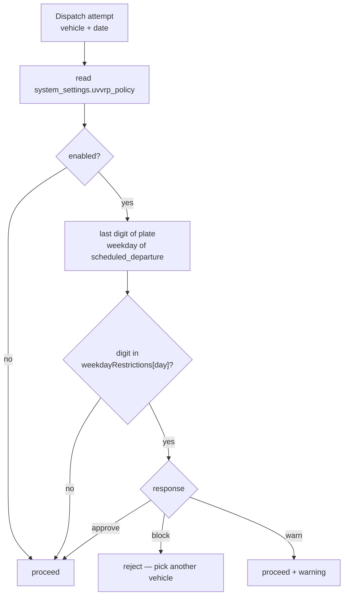

# Feature: UVVRP Number Coding

## What it does

Enforces the **Unified Vehicular Volume Reduction Program** — Metro Manila's number-coding scheme. A vehicle whose plate ends in a restricted digit may not be dispatched on its restricted weekday.

## Why it exists

It's the law in the operating city. A dispatch that violates it exposes the hotel to a fine and the guest to a stopped vehicle. This is a **domain-specific compliance rule that no generic fleet product would have** — arguably the most locally-grounded feature in the system.

## The live policy — CONFIRMED (`system_settings.uvvrp_policy`)

```json
{
  "enabled": true,
  "location": "Manila",
  "response": "block",
  "weekdayRestrictions": {
    "Mon": [1, 2], "Tue": [3, 4], "Wed": [5, 6],
    "Thu": [7, 8], "Fri": [9, 0]
  }
}
```

Standard UVVRP mapping: last plate digit → weekday. Weekends unrestricted.

The fleet vehicles page (`src/app/(dashboard)/fleet/vehicles/page.js`) surfaces
this as a **Coding Restricted** KPI card that actually filters: clicking it
toggles `filters.restrictedOnly`, which both `FleetGrid` and `FleetTable`
honour by keeping only vehicles whose plate is in the day's restricted set
(the page already computed restriction per-plate via `isRestricted()` for the
stat count — same set is reused).

## The three response modes — CONFIRMED

`src/lib/uvvrp/policy.js` supports:

| Mode | Behaviour |
|---|---|
| `block` | Reject the dispatch outright — **current setting** |
| `warn` | Allow, but surface a warning |
| `approve` | Require Fleet Manager/Admin approval before retrying dispatch |

**Making enforcement strength a runtime setting rather than a hard-coded rule is the right call.** Coding schemes get suspended (holidays, emergencies, policy changes) and the response needs to change without a deploy. That's why the policy lives in `system_settings`, not in code.

## How it works



`src/lib/uvvrp/policy.js` is **pure** — settings and date in, decision out, no I/O. Which is why it's unit-testable without a database. → [[Pure Core Imperative Shell]]

## Database tables used

`system_settings` (the policy) · `uvvrp_violations` — **0 rows**

## Violation history and verification limits

The earlier zero-row observation is historical and was not checked against live data on 2026-10-26. Current source records blocked, warned and pending-approval attempts in `uvvrp_violations`; blocking does not skip the history insert. The `approve` mode returns 409 until an authorized approval covers that vehicle and Philippine departure day. Live logging and notification delivery still need an authorized runtime check.

## What I learned

Encoding a real-world regulation as data (`weekdayRestrictions` map) rather than logic (`if (day === 'Mon' && ...)`) means the rule can change without touching code. The pure function reads the data; the data lives in the DB.

## Availability block explanation - 2026-10-03

`src/lib/uvvrp/availability-reason.js` now names number coding only when the shared `isRestricted(plate, policy, date)` predicate is true and the vehicle is not in the context's exemption set. The reason includes the evaluated plate digit, weekday, and restricted digits. If the vehicle is blocked for expired documents or its paired driver, Availability reports that separate cause. The assignment-time guard is unchanged.

## Philippine calendar consistency - 2026-10-26

Source review and failing regression tests confirmed mixed UTC, browser/server local and Philippine dates. Shared policy weekday checks now use Asia/Manila. The board's default day, seven-day forecast keys, Today marker and departure timestamps use Philippine dates/times; forecast arithmetic uses date keys, so crossing month/year boundaries or running on a different host timezone cannot shift a day.

Exemption expiry is inclusive through its Philippine calendar day. Active-exemption queries use the selected travel day instead of the database session's current day, and the forecast reevaluates expiry on each day. An approved violation now covers only its vehicle and Philippine departure day: both SQL operands use that day explicitly. The same date scope reaches picker travel contexts, individual conflict checks and batch queue conflict checks; the batch shares one exemption lookup per distinct Philippine date. Permanent category exemptions remain valid until deactivated. Substitute coverage queries use the Philippine departure date too.

Verified by reproducing the incorrect Sunday/Monday midnight result, early pass expiry, wrong substitute lookup day and cross-date approval behavior, then passing 70 focused tests in both UTC and Asia/Manila. Changed-source ESLint and focused diff whitespace checks passed. Tests replace database calls with controlled fixtures; no live policy edits, database writes, migrations, deployment or authenticated browser workflow checks were performed.

## Related

[[Dispatch]] · [[Fleet And Vehicles]] · [[Pure Core Imperative Shell]] · [[Feature Index]]
