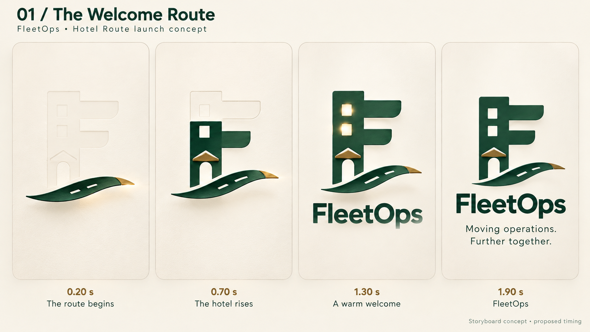
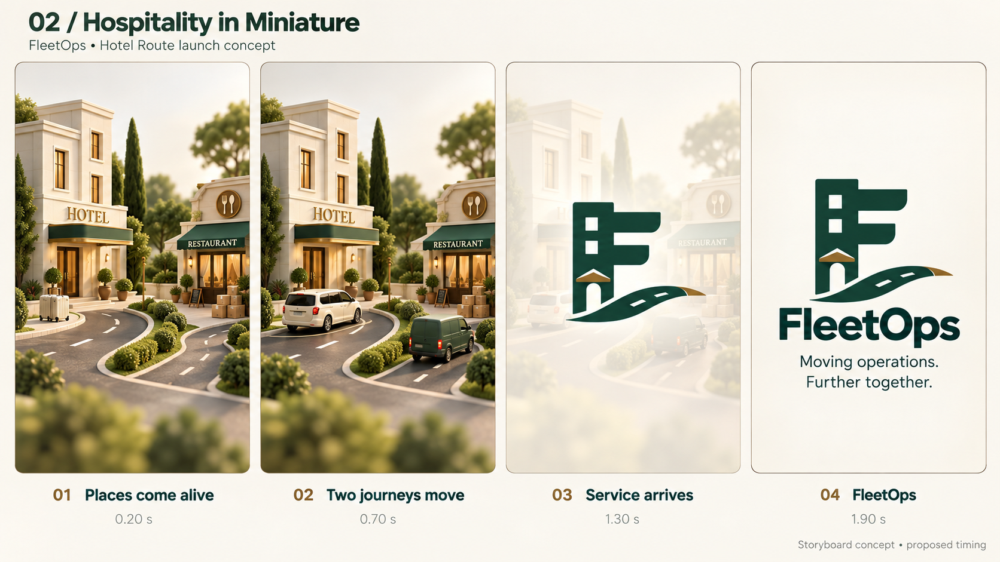
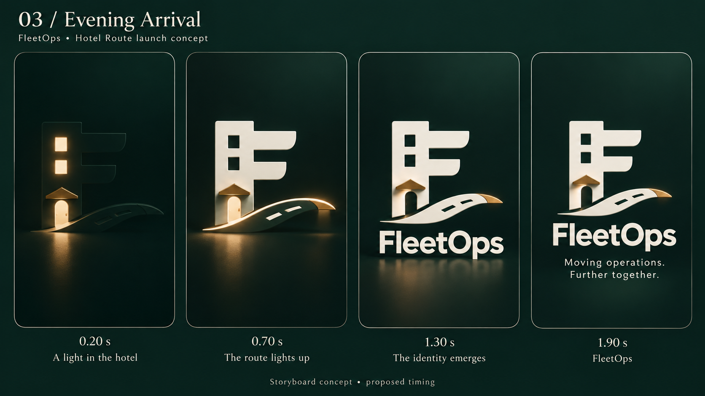
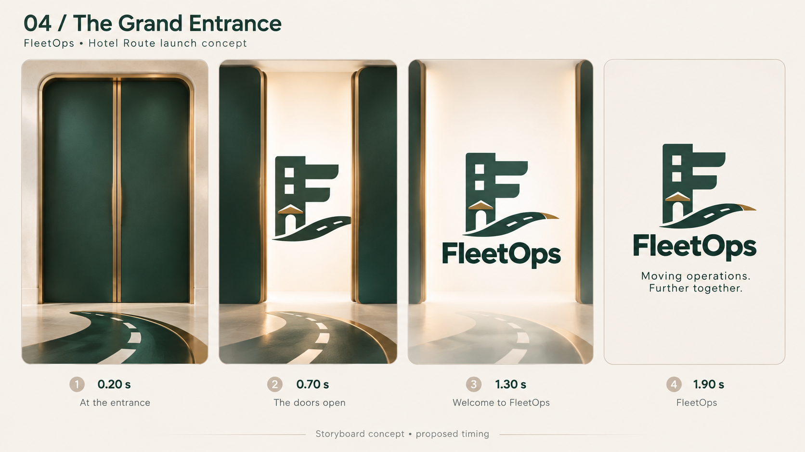

# Four FleetOps launch concepts

**Selected pair:** #1 The Welcome Route for light mode, with the later wordmark-reflection revision; #3 Evening Arrival for dark mode. See [the selected light/dark reference](selected-light-dark-launch-2026-10-28.md). The four originals below are retained as concept history.

**Selected logo:** #2 Hotel Route from the third logo board. The owner explicitly selected it before requesting these four launch concepts. This selection is recorded for future work; the app has not been changed.

Created 2026-10-28 with the built-in image generation tool, one call per storyboard. Each board shows four proposed animation checkpoints at 0.20, 0.70, 1.30 and 1.90 seconds. These are design images, not playing animations or measured device timing.

| Concept | Motion idea | Character |
| --- | --- | --- |
| 01 The Welcome Route | Reveal the road, fill the hotel F, light the windows, show the wordmark | Clean and restrained |
| 02 Hospitality in Miniature | Guest and supply vehicles approach their hotel and restaurant destinations; crossfade to logo | Most explicit about the services |
| 03 Evening Arrival | Illuminate windows and the route, then settle into ivory branding on forest | Quiet luxury |
| 04 The Grand Entrance | Slide entrance panels apart to reveal the stationary logo, then fade the architectural setting | A warm hotel welcome |

## 01 / The Welcome Route

[Exact generation prompt](01-welcome-route-prompt-2026-10-28.md)

## 02 / Hospitality in Miniature

[Exact generation prompt](02-hospitality-in-miniature-prompt-2026-10-28.md)

## 03 / Evening Arrival

[Exact generation prompt](03-evening-arrival-prompt-2026-10-28.md)

## 04 / The Grand Entrance

[Exact generation prompt](04-grand-entrance-prompt-2026-10-28.md)

## Verification and future implementation

All four saved PNGs match their generated originals byte for byte. Visually reviewed four-state progression, the chosen hotel-F/road identity, final FleetOps/tagline text, and meaningful differences between the concepts. The second concept rendered as a detailed architectural miniature rather than the simpler clay scene originally requested in its prompt; the reference image is the actual visual deliverable.

Generated logo proportions, texture, road dash spacing/count in intermediate stages and scale can vary. These boards are visual direction, not a claim of pixel-perfect logo reproduction. Before implementation, create one approved precise vector master of Hotel Route and use it throughout every stage; do not manually recreate each generated frame. Use separate background/vehicle/door layers and bounded transforms or masks, avoiding unproven building-to-letter morphs. Retain static reduced-motion/error fallbacks, high-contrast support, theme/font/auth gates, bounded launch completion and no foreground replay. Runtime timing, native performance and visual fidelity remain untested; the owner subsequently selected #1 for light and #3 for dark as recorded above.
