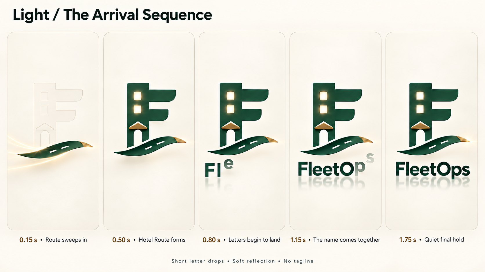
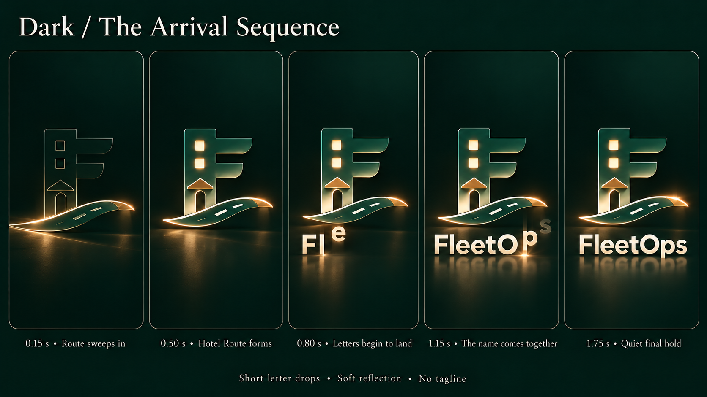

# Letter-arrival launch: light and dark

The owner supplied a detailed 15-state storyboard and asked for an opinion on using its movement with the existing selected design in both themes. This is a new **proposal for review**, not authorization to implement the launch. The selected Hotel Route logo, light/dark family, reflection and no-tagline decision remain.

## Design judgment

The road sweep, hotel-F formation and left-to-right letter arrival make a clear sequence. Keep the drops small, the light restrained and the final hold still. Compared with the previous whole-word rise, this is more expressive. It replaces that motion only in this candidate.

The supplied reference's displayed timestamps restart after the first row. Use one continuous clock when implementing rather than literal panel numbering or a pause at every panel. The new boards sample 0.15, 0.50, 0.80, 1.15 and 1.75 seconds. Illustrative timing target: road 0.00–0.35 s; logo forms by about 0.55 s; letters start at 0.60 s at roughly 75 ms intervals, each settling over about 180 ms; all letters are settled by about 1.35 s; final reflection/glint resolves by about 1.50 s; quiet hold until about 1.90 s, then the existing bounded fade. These are proposed values, not measured runtime.

Reserve the final eight-letter FleetOps layout from the start, so letters never shift sideways as more arrive. Preserve the brand font and letter spacing rather than rendering eight loosely spaced text boxes. Reflection follows settled letters and remains a decorative, short fading layer. No tagline. Recommend silent by default; audio captions in the reference are not a selected sound requirement.

## Light preview

Warm ivory, forest lettering/mark, brass sweep and a soft forest reflection.

[Exact light prompt](05-letter-arrival-light-v1-prompt-2026-10-28.md)

## Dark preview

Deep forest, ivory/champagne wordmark, warm hotel windows and restrained edge light. The generated board adopts the supplied reference's green-and-brass mark rather than the prompt's ivory-body adaptation; it is an alternative finish for review, not proof of contrast acceptance. The final native asset must retain a clearly visible hotel silhouette at ordinary brightness.

[Exact dark prompt](05-letter-arrival-dark-v1-prompt-2026-10-28.md)

## Source reference

[Owner-supplied choreography board](user-letter-drop-reference-2026-10-28.png)

The prior whole-word-rise treatment remains available in the [selected pair history](selected-light-dark-launch-2026-10-28.md).

## Verification and limits

Both generated boards were visually reviewed for five ordered checkpoints, Hotel Route features, partial letter arrival, correct final FleetOps spelling, reflection and no tagline. All saved copies, including the user's source reference, match their original files byte for byte. Documentation UTF-8, whitespace and local reference links were checked.

They are static concept images. Intermediate character positions and logo details are approximate; no frame-rate, playback, device or exact-vector acceptance is claimed. Future implementation must keep one approved vector master, existing theme preference and launch lifecycle, a completed static reduced-motion/error state, and plain high-contrast branding without glow/reflection. No application source, production asset, database, dependency or deployment changed.
