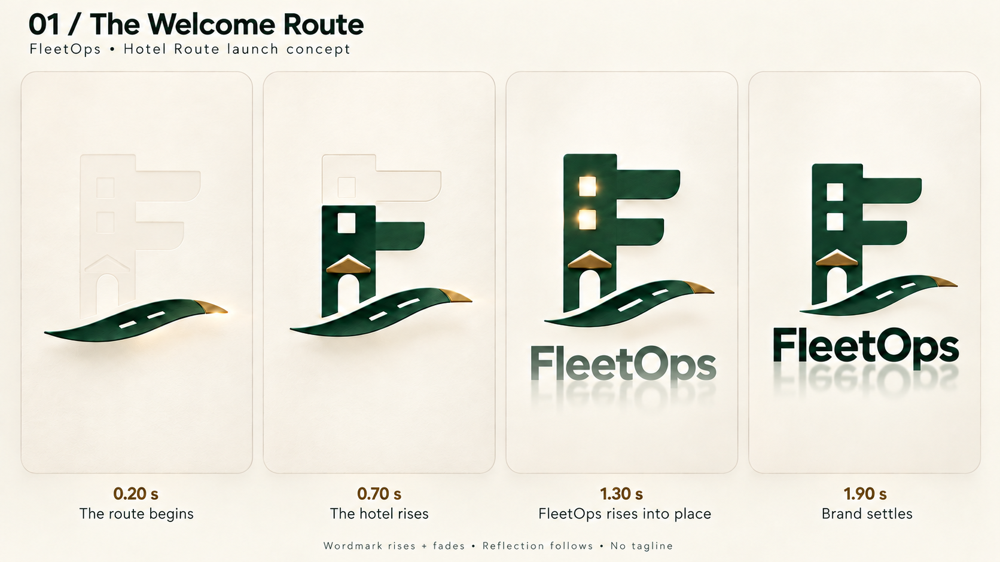
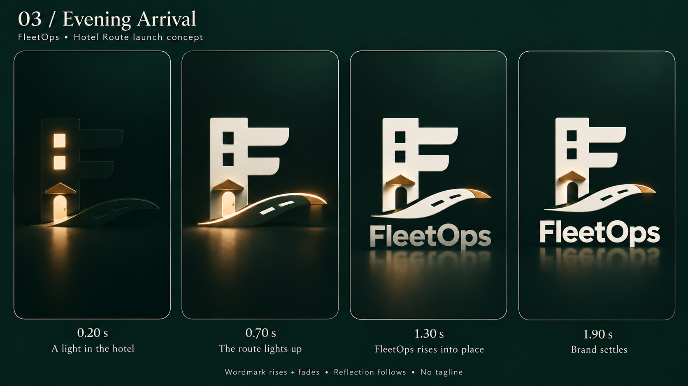

# Selected FleetOps launch pair

The owner selected **The Welcome Route (#1) for light mode** and **Evening Arrival (#3) for dark mode** on 2026-10-28. Both use the previously selected **Hotel Route logo (#2 from the third logo board)**. These are visual selections for the later app build, not implemented runtime changes.

**New reference under review:** the owner has proposed individual letter arrivals using an attached storyboard. See [the light/dark letter-arrival proposal](letter-arrival-light-dark-review-2026-10-28.md). The whole-word-rise treatment below is retained as the previous design. The selected logo, theme family, reflection and no-tagline decision are unchanged; no implementation is authorized or claimed here.

## Light mode: The Welcome Route, with reflection

FleetOps gently rises and fades in as one unit, with a short mirrored reflection appearing just afterward. The 1.30 s frame shows the name during its reveal; the 1.90 s frame shows the settled identity. The tagline is absent. The [previous reflection revision](01-welcome-route-reflection-v2-2026-10-28.png) and [original light board](01-welcome-route-2026-10-28.png) are retained for history.

Generated using the built-in image generation tool. [Exact light edit prompt](01-welcome-route-wordmark-v3-prompt-2026-10-28.md).

## Dark mode: Evening Arrival

The dark revision preserves warm window/route lighting and gives FleetOps the same one-unit rise/fade treatment with an aligned faint reflection. The tagline is absent. [Exact dark edit prompt](03-evening-arrival-wordmark-v2-prompt-2026-10-28.md). [Previous dark board](03-evening-arrival-2026-10-28.png) is retained for history.

## Proposed wordmark choreography

Start around 1.05 s after the mark resolves. Move the complete FleetOps wordmark upward about 8–10 logical pixels while fading to full opacity over about 300 ms. Let the reflection begin its fade about 60 ms later, but keep it aligned with the same transformed wordmark. Settle both by approximately 1.45–1.50 s, leaving a brief still hold before the bounded exit. No extra launch delay is intended. These are suggested design timings, not measured app behavior.

## Future implementation constraints

Choose the visual treatment from the existing app theme, which follows the device setting by default and supports saved light/dark overrides; do not switch by clock time. High-contrast variants keep a plain solid mark and wordmark without reflections. Keep the reflection decorative and absent from accessibility announcements. Reduced motion uses the completed static brand without moving shimmer or reflection effects. It must not extend the bounded launch or change startup, auth, font or navigation behavior.

Use one approved exact Hotel Route vector master and one wordmark geometry throughout both modes. Generated artwork is approximate, not an animation asset master. Keep the reflection within available space and check small native screens. The launch's single accessibility label should become “FleetOps” when the tagline is removed; the reflection must not be announced. This removal is scoped to launch, not other brand surfaces.

## Verification

Both revised PNGs were visually reviewed for the absent tagline, partial-to-settled wordmark, reflections, selected Hotel Route identity and four-state sequence. Saved files were confirmed byte-identical to their generated originals. Documentation encoding/whitespace and local reference links were checked. No application source or production asset changed, and no native animation/device acceptance is implied.
